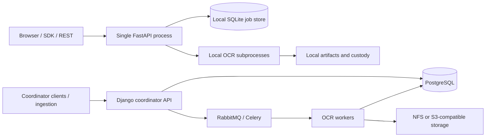

# EDCOCR architecture — v4.2.0-rc.1

The candidate has two separate job services. Choose the service that owns your jobs before selecting a deployment. The browser application and SDKs use the standalone FastAPI service; those jobs are not automatically submitted to the Django worker farm.

## Single-host API

The supported candidate starting point is one API process per local database and output root. Linux process ownership prevents another process from concurrently recovering or writing the same jobs. Background filesystem writers remain registered until they finish; shutdown drains them before releasing ownership. Use a local filesystem for SQLite, rather than putting the API database on NFS.

The CPU SOLO overlay builds the OCR base before its API image, uses distinct watched and API upload directories, and defaults to one concurrent API job. The batch service scans its input directory and exits when finished; its restart policy controls another scan. See [installation](INSTALL.md).

## Scalable coordinator workers

The coordinator persists jobs and page state in PostgreSQL, dispatches through RabbitMQ, and uses Redis for Celery results and coordination. Workers can be replicated against the same coordinator and configured artifact backend. Page leases, generations, and publication fences reject stale output. This is independent of standalone API job scheduling.

Single-host container replay verifies bounded distributed behavior. Physical multi-host networking, real GPU execution, AWS IAM, NFS export behavior, mutual TLS, and replicated database recovery need acceptance on the intended infrastructure. Helm and federation configuration do not establish those claims. Unsupported federation mutual-TLS configuration is rejected. See [candidate scope](docs/release-candidate.md).

## OCR and evidence

`ocr_gpu_async.py` is the pipeline entry. Extraction, recognition, assembly, and compression exchange bounded work queues. Concurrency is configuration-dependent. CTC recognition and non-generative fallback preserve source evidence; optional translation and other generative features are separate and disabled by default. OCR accuracy is not guaranteed by a decoder choice.

Native PDF preservation verifies every page before taking the whole-document fast path. Unsupported text-font combinations fail closed rather than silently dropping text. A supported Latin fallback handles ASCII when the selected script font lacks those glyphs. Compression validates rendered content and geometry.

Custody records are hash chained. They make alterations detectable when checked against a trusted record; a local hash chain alone is not an external timestamp, legal certification, or proof that storage was never modified.

## Storage and deletion

Coordinator storage bindings are persisted per job. S3 access supports explicit static credentials or the SDK credential-provider chain. Worker presigned URL hosts are explicitly allowed; control-plane identity is not implicitly assigned to workers.

Purge and retention wait for staged OCR cleanup. Deleting an S3 job creates a durable backend-bound cleanup record in the same database transaction. Recovery revisits the exact job prefix to remove uploads that arrive late. This is eventual current-object cleanup, not immediate erasure of versions, retained objects, or backup copies. Keep the recovery scheduler running, monitor failures and backlog, and never reuse retired job UUIDs.

Migration 0032 cannot be reversed while cleanup records exist. An older application does not service these records. Preserve the database and cleanup service during rollback; see [upgrade notes](INSTALL.md#upgrade-and-rollback).

## Optional integrations

Translation, document enrichment, federation, cloud providers, and specialist workers expose extension surfaces with their own dependencies and acceptance requirements. Historical design documents remain for reference; they do not expand the release candidate's verified scope.
