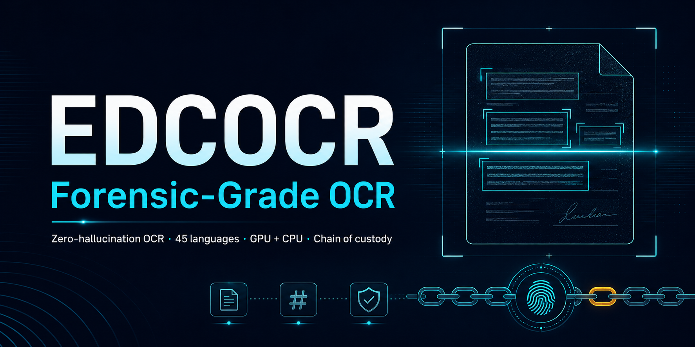

<p align="center"></p>

# EDCOCR

OCR for searchable PDFs, extracted text, and auditable document processing.

**v4.2.0-rc.1 is a release candidate.** Its intended deployment is one standalone
API process on one host, or the separate Django coordinator API with scalable
OCR workers. Those APIs have separate job stores. See the
[candidate scope and limits](docs/release-candidate.md) before deployment.

[Installation](INSTALL.md) · [API reference](docs/API-REFERENCE.md) ·
[SDKs](docs/08-SDK-REFERENCE.md) · [Changes](CHANGELOG.md) ·
[Security](SECURITY.md) · [License](LICENSE)

## CPU quickstart

Use Linux Docker Engine and Docker Compose **2.24.4 or newer**. WSL2 and other
hosts need their own acceptance checks. The first build downloads dependencies
and models; allow sufficient disk space and time.

```bash
git clone https://github.com/mattmre/EDCOCR-PUBLIC.git
cd EDCOCR-PUBLIC
# Select the reviewed release-candidate ref when it is published.
sudo install -d -m 0750 -o 1000 -g 1000 \
  ocr_source ocr_api_source ocr_output ocr_temp
export OCR_API_KEY=local-demo-key-change-before-use
bash scripts/with_runtime_source.sh root-cpu docker compose \
  -f docker-compose.solo.yml -f docker-compose.solo.cpu.yml \
  --profile api up -d --build
curl -fsS http://127.0.0.1:8088/api/v1/health
curl -fsS -H "X-API-Key: $OCR_API_KEY" \
  -F file=@your-document.pdf http://127.0.0.1:8088/api/v1/jobs
```

Poll `/api/v1/jobs/{job_id}` until terminal, then list
`/api/v1/jobs/{job_id}/outputs`. Keep `ocr_output` across restarts: it contains
the API database and job artifacts. API uploads use `ocr_api_source`; the
batch pipeline scans the separate `ocr_source` folder. The standalone API
defaults to one concurrent job. Measure memory and throughput before increasing
concurrency.

```bash
docker compose -f docker-compose.solo.yml -f docker-compose.solo.cpu.yml \
  --profile api down
```

Stopping the stack with this command retains the bind-mounted data. For
upgrade, rollback, worker scaling, and GPU requirements, use [INSTALL.md](INSTALL.md).

## Processing and extensions

- Preserve source evidence when OCR fails; report incomplete or reviewable output.
- Produce searchable PDF, text, validation metadata, and custody records.
- Submit and inspect jobs through HTTP APIs or the Python and TypeScript SDKs.
- Scale distributed OCR through the coordinator, RabbitMQ, and workers.
- Enable extraction, translation, and model-assisted extensions explicitly;
  they do not replace source text on the forensic OCR path.

AWS/IAM, physical multi-host and GPU deployments, service-mesh mutual TLS,
real NFS, and replicated restore require target-specific acceptance. The chart
refuses its unsupported federation mutual-TLS flag. Local fixtures establish
bounded behavior; they do not establish production capacity or recovery targets.

## Development and support

See [DEVELOPMENT.md](DEVELOPMENT.md) for local checks and
[CONTRIBUTING.md](CONTRIBUTING.md) for contribution guidance. Local command
output and artifacts are release evidence; hosted workflow badges are not
release qualification.

[Issues](https://github.com/mattmre/EDCOCR-PUBLIC/issues) ·
[Discussions](https://github.com/mattmre/EDCOCR-PUBLIC/discussions) ·
[Security reporting](SECURITY.md)
